# Dossier de React Native con Expo y Android Studio

## Crear y ejecutar un proyecto Expo

En primer lugar se creó el proyecto con los siguientes comandos;

```bash
npx create-expo-app@latest dossier-react-native --template default
cd dossier-react-native
code .
npx expo start
```

Tras esto se empezó con la práctica número 1.

### Práctica 1. Hola mundo

En esta práctica se creó una pantalla que muestre un Hola mundo en nuestro emulador, se utilizó el siguiente código base:

```tsx
import { StyleSheet, Text, View } from 'react-native';

export default function Index() {
  return (
    <View style={styles.pantalla}>
      <Text>¡Hola mundo! Soy ...</Text>
    </View>
  );
}

const styles = StyleSheet.create({
  pantalla: {
    alignItems: 'center',
    backgroundColor: 'lightpink',
    flex: 1,
    justifyContent: 'center',
  },
});
```

El resultado fue el siguiente:


### Práctica 2. Contador con dos botones

En la práctica 2 se realizo mediante el siguiente código base una app con dos botones que incrementan o decrementan un contador.

```tsx
import { useState } from 'react';
import { Button, StyleSheet, Text, View } from 'react-native';

export default function ContadorScreen() {
  const [contador, setContador] = useState(0);
  return (
    <View style={styles.caja}>
      <Text>Contador: {contador}</Text>
      <Button title="Incrementar" onPress={() => setContador(n => n + 1)} />
    </View>
  );
}
const styles = StyleSheet.create({
  caja: { alignItems: 'center', borderWidth: 2, padding: 20 },
});
```

```tsx
const styles = StyleSheet.create({
  contenedorCircular: {
    backgroundColor: 'rgba(191, 186, 221, 0.54)',
    borderRadius: 100,
    padding: 20,
  },
});
```
El resultado fue el siguiente:

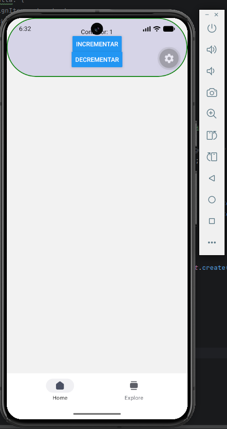
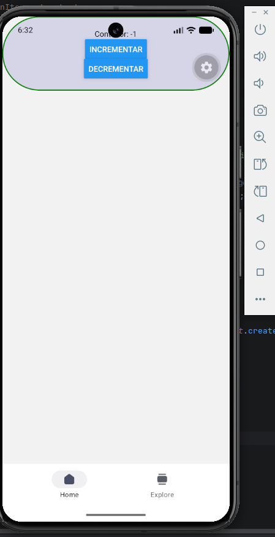


### Práctica 3. `InicioScreen` y estilos separados

Cread `src/screens/E2.tsx` para colocar el contador de la práctica 2. En `src/screens/E1.tsx`, importad y mostrad `<InicioScreen />`. Los estilos deberán declararse mediante `StyleSheet.create()`.

**Para conservar las prácticas:** en este momento podéis guardar el «Hola mundo» como `src/screens/E1.tsx`. Después crearemos un índice de rutas para abrir cada pantalla por separado; no eliminéis el código del primer ejercicio. `src/screens/` contiene la implementación y `src/app/` actuará como enlace a ella cuando configuremos las rutas.

```tsx
// src/app/index.tsx (hasta crear el menú general)
import InicioScreen from '../screens/InicioScreen';
export default function Index() {
  return <InicioScreen />;
}
```

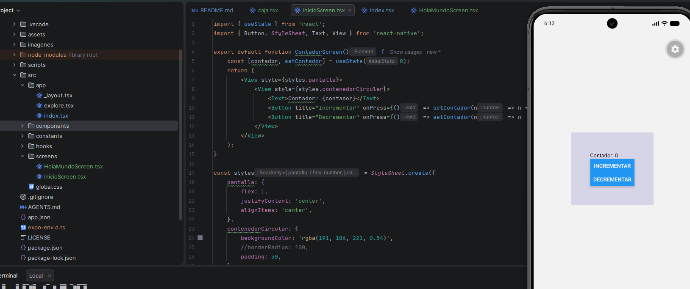

### Layout con Flexbox

React Native emplea Flexbox para distribuir componentes. Frente al CSS del navegador, los contenedores se organizan **en columna por defecto** (`flexDirection: 'column'`) y no necesitan `display: 'flex'`. Las unidades numéricas de `width`, `height`, `margin` o `padding` se expresan normalmente como unidades lógicas, sin añadir `px`.

Con `flex: 1` un contenedor ocupa el espacio libre. `flexDirection: 'row'` coloca los hijos en horizontal y `flexDirection: 'column'` los coloca en vertical.

```tsx
// src/components/Caja.tsx
import { StyleSheet, Text, View } from 'react-native';

type Props = { nombre: string; bg?: string };
export default function Caja({ nombre, bg = 'green' }: Props) {
  return (
    <View style={[styles.caja, { backgroundColor: bg }]}>
      <Text>{nombre}</Text>
    </View>
  );
}
const styles = StyleSheet.create({
  caja: { height: 100, width: 100, justifyContent: 'center', alignItems: 'center' },
});
```

La sintaxis `style={[styles.caja, { backgroundColor: bg }]}` combina un estilo base y un valor personalizado, también se puede utilizar la extensión de objetos con `...styles.caja`.


### Práctica 4. Tres cajas

Cread una pantalla `PrincipalScreen` con el texto «Contenedor Principal» y un `View` para el escenario. Dentro colocad tres componentes `Caja` de 100 × 100 y enviadles colores diferentes mediante propiedades. El escenario debe tener `flex: 1`.

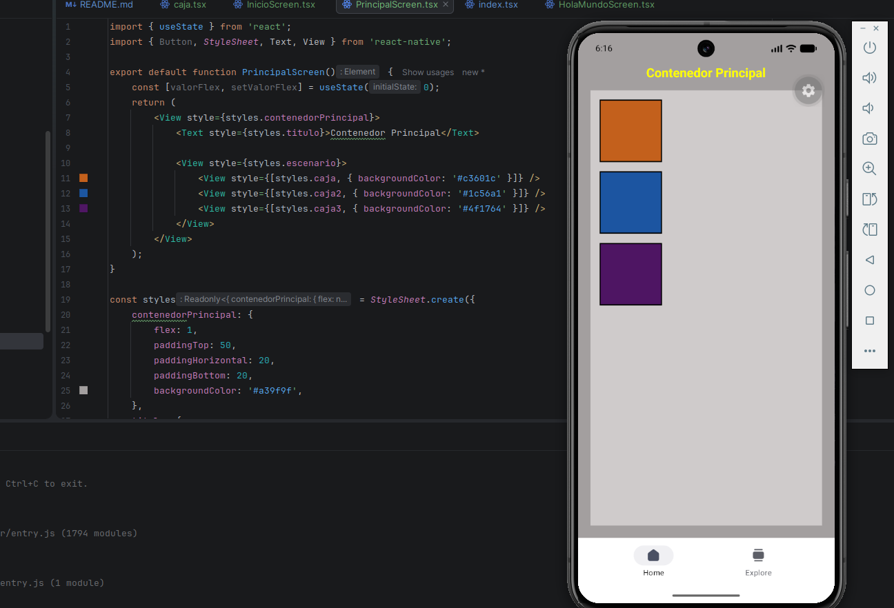


### Reparto del espacio con `flex`

`flex` controla cómo se reparte el espacio libre entre elementos hermanos. Dos hijos con `flex: 1` comparten ese espacio; si uno tiene `flex: 2`, recibe el doble de la parte asignada al que tiene `flex: 1`, siempre que las restantes restricciones de tamaño lo permitan.

**Atención:** si una caja tiene `height: 100`, el efecto de `flex` puede verse condicionado por esa altura. Para observar claramente el reparto en la siguiente práctica, podéis usar una variante de la caja sin altura fija.

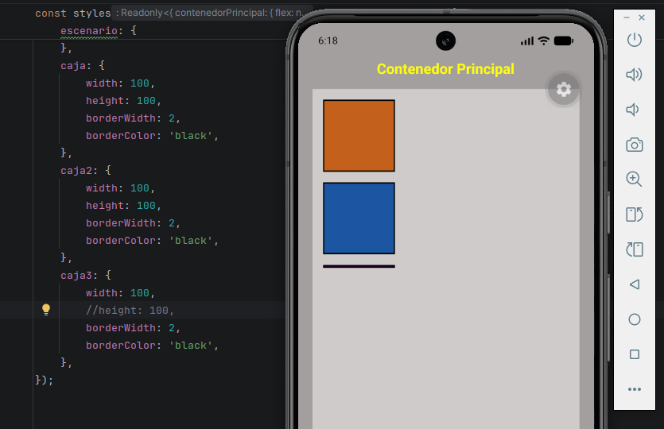

### Práctica 5. Modificar `flex` dinámicamente

Añadid a cada caja dos botones: uno incrementará su valor de `flex` y otro lo disminuirá. Mostrad el valor actual de cada caja y comprobad cómo se reorganiza el espacio. Guardad los valores en estados independientes y evitad valores negativos cuando no tengan sentido para vuestro diseño.

```tsx
const [valorFlex, setValorFlex] = useState(0);
// Aplicad { flex: valorFlex } al contenedor de la caja.
// Botones: setValorFlex(n => n + 1) y setValorFlex(n => Math.max(0, n - 1)).
```

El resultado debe seguir siendo consultable cuando paséis a los siguientes ejercicios.

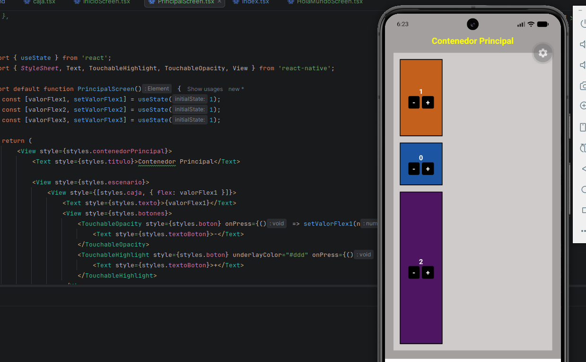

### `TouchableOpacity` y `TouchableHighlight`

Los botones nativos permiten poca personalización. React Native incluye componentes que reaccionan al tacto y pueden envolver una interfaz personalizada. `TouchableOpacity` reduce la opacidad al pulsar; `TouchableHighlight` muestra un resaltado. Ambos utilizan `onPress`.

```tsx
import { Alert, Text, TouchableHighlight, TouchableOpacity } from 'react-native';

<TouchableHighlight onPress={() => Alert.alert('Pulsado')} underlayColor="#ddd">
  <Text>Botón destacado</Text>
</TouchableHighlight>

<TouchableOpacity onPress={() => Alert.alert('Pulsado')}>
  <Text>Botón con opacidad</Text>
</TouchableOpacity>
```

En aplicaciones actuales también puede utilizarse `Pressable`, pero para observar las diferencias entre los componentes táctiles trabajaremos aquí con los dos componentes anteriores.

### Práctica 6. Sustituir los botones

Sustituid los botones de la práctica 5: para `flex + 1`, utilizad un `TouchableHighlight` que muestre una alerta y aumente el valor; para `flex - 1`, utilizad `TouchableOpacity` y reducid el valor. Personalizad el aspecto de ambos.


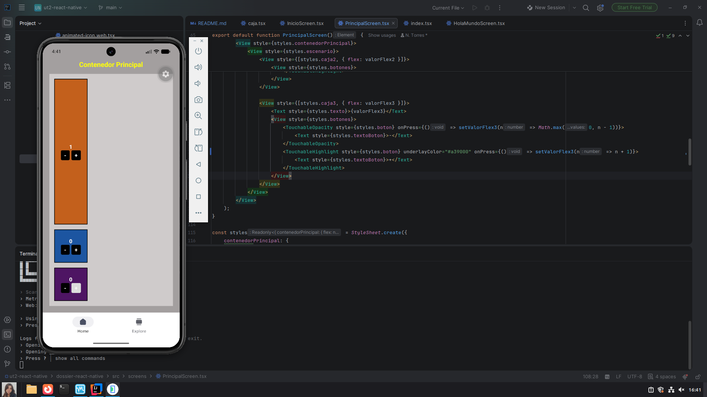
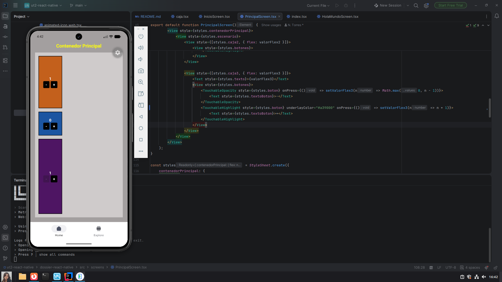

### Práctica 7. Nombre y estilos personalizados

Adaptad la pantalla para que cada caja muestre su nombre (Caja A, B y C) y acepte estilos enviados mediante propiedades. Al menos una caja debe tener esquinas redondeadas y un borde diferente, como se describe en la actividad.[PrincipalScreen.tsx](src/screens/PrincipalScreen.tsx)

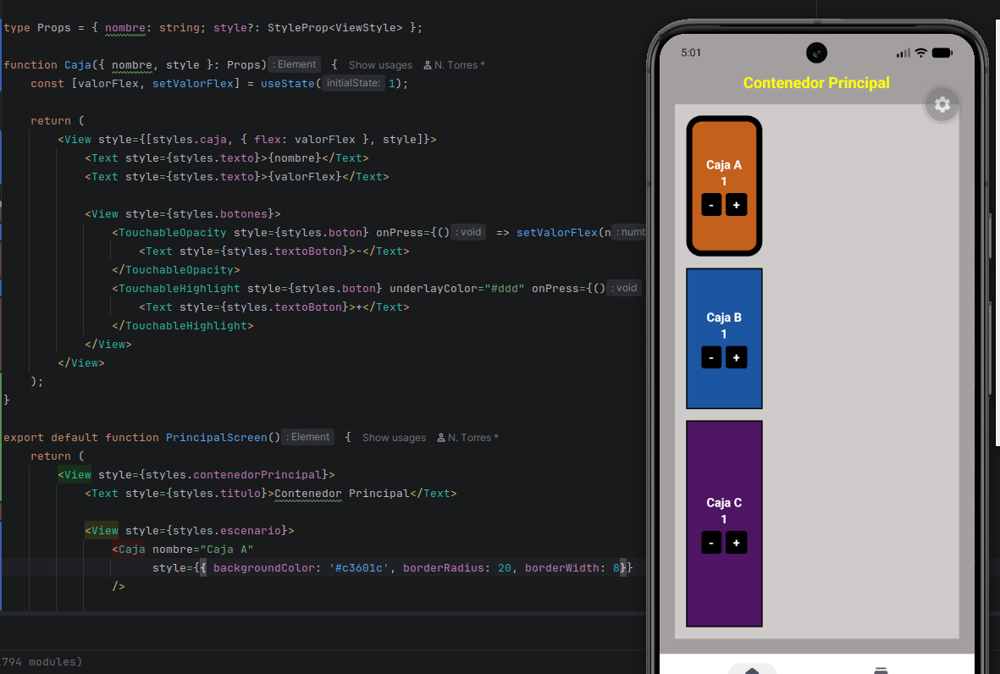

### Práctica 8. Círculos dinámicos

Comenzad con un escenario vacío. Un botón añadirá un círculo de color variable; otros dos alternarán `wrap/nowrap` y `row/column`. Mostrad los controles como botones personalizados (`TouchableOpacity`). Evitad que los valores RGB superen 255; podéis limitar el cálculo con `Math.min(255, valor)`.

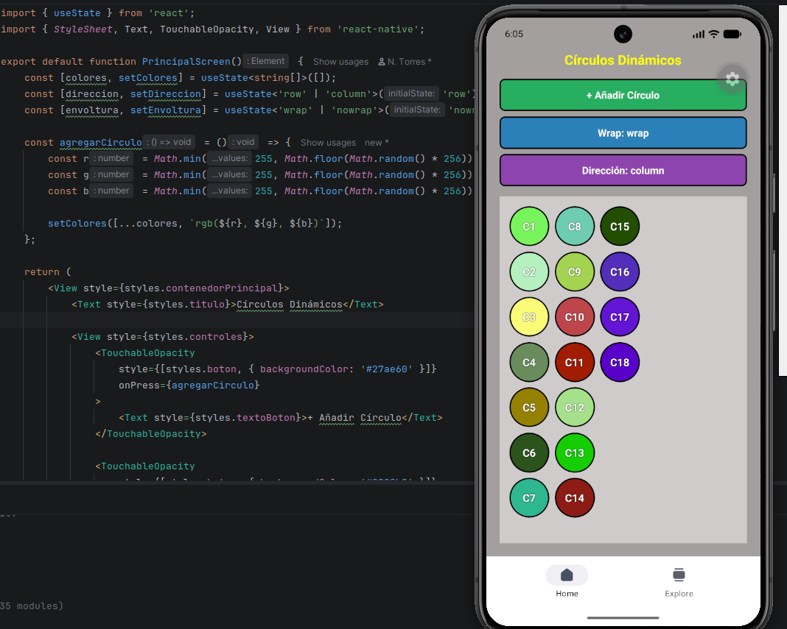
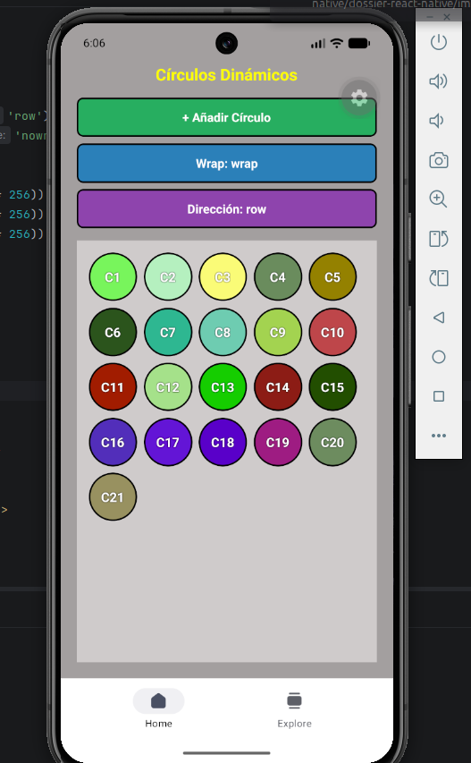
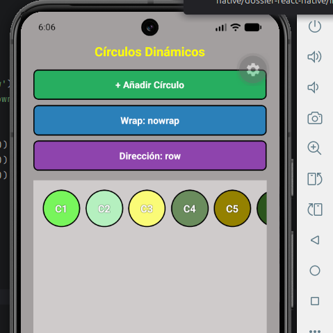


### Práctica 9. Distribución, alineación e imágenes

Cread una pantalla con estos elementos: un campo de texto que permita elegir un valor válido de `justifyContent`, botones para modificar `alignItems` y tres imágenes. **Al menos una de las imágenes deberá cargarse desde los archivos del proyecto mediante `require`**. Las otras pueden ser remotas o locales. Utilizad `flexWrap: 'nowrap'` para observar el efecto de las alineaciones respecto al contenedor.

Indicad en pantalla cuál es la alineación activa, de forma que pueda comprobarse el funcionamiento.

